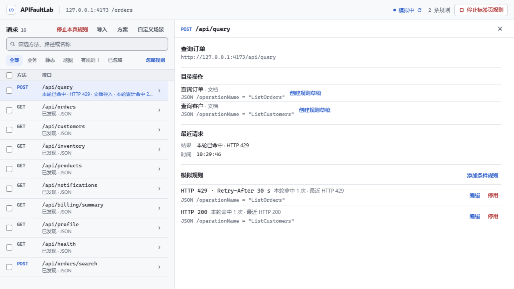
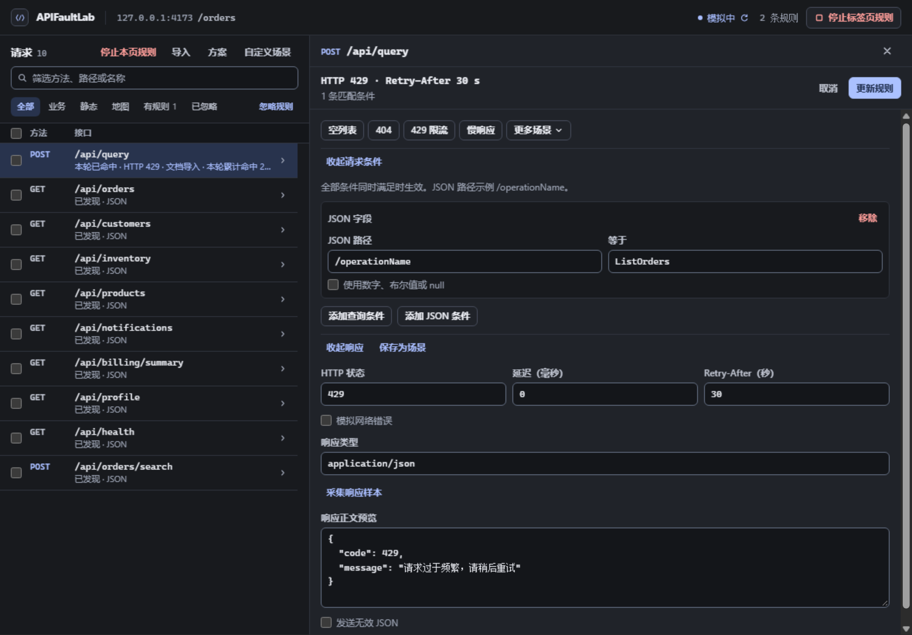

# APIFaultLab

[简体中文](README.md) · English

**A Chrome DevTools extension that automatically discovers page requests and simulates API failures in batches.**

Open APIFaultLab in DevTools and use the page as usual. The workbench captures the requests the page makes and groups them by page URL. To test an orders page's empty state, select its query endpoints, set them all to return empty lists, and rerun the queries. Check the resulting page and see which rules matched.



## Contents

[Installation](#installation) · [Usage](#usage) · [Features](#features) · [Request scope and data](#request-scope-and-data) · [Development and verification](#development-and-verification) · [Contributing](#contributing) · [License](#license)

## Installation

Use **Chrome 142 or later** and **Node.js 22.12 or later in the 22.x series, or Node.js 24 or later**. Clone the repository and build the extension.

```bash
git clone https://github.com/zhkai-ybwn/APIFaultLab.git
cd APIFaultLab
npm ci
npm run build
```

If you already downloaded the source, run `npm ci` and `npm run build` from the project root.

1. Open `chrome://extensions` in Chrome and turn on **Developer mode**.
2. Choose **Load unpacked** and select the project's `.output/chrome-mv3` directory.

After rebuilding, reload the extension from that page, then close and reopen DevTools.

## Usage

### Discover requests and apply a batch of mocks

1. **Connect to the page.** Open the page you want to test and select **APIFaultLab** in DevTools. Check the `»` menu when the panel is hidden. Use **Authorize this site** (授权此站点), or click the extension icon in Chrome's toolbar to grant temporary access to the current page.
2. **Discover requests.** Navigate the page, submit a query, or change pages in a table. Requests appear as the page makes them. Changing the URL shows that page's requests. Actions that keep the same URL stay in the same group.
3. **Set up the batch.** Search or use the **Business** (业务) filter to narrow the list. Select the endpoints you want, or use the column header checkbox to select the visible results. Open **Batch setup** (批量设置), choose a response such as HTTP 404, 429, empty data, or a slow response, and click **Enable N rules** (启用 N 条规则) at the top of the details pane.
4. **Check the result.** Repeat the original action on the page and check the response and rule matches in the workbench. To keep the rules for retesting, open **Plans → Create from current rules** (方案 → 从当前规则创建). When finished, choose **Stop rules for this page** (停止本页规则) and trigger the request again to get the real response.

For a single endpoint, click the request row, choose **Add mock rule** (添加模拟规则), and enable it from the top of the details pane. Batch updates preserve the matching conditions of existing rules.

### Try the local demo

```bash
node examples/manual-demo/server.mjs
```

1. Open the [local demo](http://127.0.0.1:4173/orders), connect APIFaultLab in DevTools, and click **Query orders** (查询订单) and **Query customers** (查询客户). Both operations use `POST /api/query`.
2. Add a rule for orders. Match the JSON field `/operationName` to `ListOrders` and choose HTTP 429. Run both queries again. The order request returns 429 and the customer request returns 200.
3. Add a second rule matching `ListCustomers`. Select `POST /api/query`, batch-update both rules to HTTP 404, and enable them. Both queries return 404. **Query version** (查询版本) still returns 200 because it matches neither rule.
4. Choose **Stop rules for this page** (停止本页规则) and run the order query again to see HTTP 200. Use **Read counts** (读取计数) on the demo page to check which requests reached the local server.



## Features

| Task | How it works |
| --- | --- |
| Find business endpoints in a busy request list | Search by method, path, or name. Filter business, static, or map requests, ignore selected endpoints in bulk, or save site-specific path prefixes. |
| Test errors, empty states, and slow loading | Choose HTTP errors, an empty list or object, HTTP 204, a slow response, or a network error. Edit status, body, and delay, then save them as a reusable scenario. |
| Mock one operation on a shared POST endpoint | Match a query parameter or JSON field. Order and customer queries on the same path can receive different responses. |
| Reuse rules across test runs | Save matching conditions, responses, and retest notes as a plan. Enable it from its page, or export a summary or importable JSON file. |
| Add endpoints to a page's catalog | Import OpenAPI 3.0/3.1 or Swagger 2.0 in JSON or YAML, or import an APIFaultLab catalog JSON. Use catalog entries to create rule drafts with matching conditions. |

An agent can turn project source, API documentation, or authorized request records into a catalog JSON to import into the workbench. Use the full URL of the page under test. See the [catalog Skill](skills/apifaultlab-catalog/SKILL.md), [catalog format](skills/apifaultlab-catalog/references/接口目录格式.md), and [shared POST example](skills/apifaultlab-catalog/references/共用请求目录.json).

## Request scope and data

- **Request scope.** Capture and simulation cover Fetch and asynchronous XHR from the main page. To test requests made during page load, authorize the site and prepare startup interception before reloading in the same tab. See the [user guide](docs/使用说明.md) for connection and recovery steps.
- **Session controls.** Use the toolbar popup to view capture status, pause capture, or stop simulation across the tab. Choose **Stop rules for this page** (停止本页规则) in the workbench to limit the action to the current page.
- **Backups.** Plans, catalogs, ignore rules, and custom scenarios are stored in the current Chrome profile. In **Plans → Data backup** (方案 → 数据备份), export JSON or preview additions, duplicates, and conflicts before restoring. Backups can contain page addresses, matching values, and response bodies. See the [privacy notice](docs/隐私说明.md).


## Development and verification

The extension uses Manifest V3, WXT, Vue 3, and TypeScript. After installing dependencies, run the type check, tests, and Chrome build from the project root.

```bash
npm run typecheck
npm test
npm run build
```

Run `npm run zip` to package the Chrome extension. After building, `npm run test:chrome` runs the local DevTools regression suite with a temporary Chrome profile. Set `APIFAULTLAB_CHROME_PATH` if Chrome is installed in a custom location. See the [architecture notes](docs/plans/技术选型与架构设计.md).

## Contributing

For questions, bug reports, or suggestions, use [GitHub Issues](https://github.com/zhkai-ybwn/APIFaultLab/issues). Pull requests are welcome. For a bug report, include the Chrome version, steps to reproduce, and the expected and actual results. The local demo or sanitized request details can help isolate an API issue.

Before submitting changes, run the relevant tests and say how you verified them. See the [project license](LICENSE) for contribution terms.

## License

The source code is publicly available under the **APIFaultLab Free Personal and Internal Use License 1.0**. Individuals and organizations can use it for free and modify it locally. An organization can use it internally to develop and test commercial projects. Keep the original attribution and license. To distribute it to third parties, publish it separately in an extension store, or charge for supplying the extension, obtain prior written permission from the relevant rights holders. See the [full license](LICENSE).

The extension package includes the project license and [third-party notices](THIRD-PARTY-NOTICES.md).
