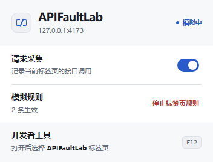

# APIFaultLab

[简体中文](README.md) · English

**A Chrome DevTools extension that automatically discovers page requests and simulates API failures, custom response headers, and retry flows in batches.**

Open **APIFaultLab** in DevTools and use your page as usual. Fetch and asynchronous XHR requests are captured automatically and grouped by page URL. You can select multiple query endpoints to mock empty states at once, split a shared `POST /api/query` by request header or JSON field, or set a max hit count to verify frontend retry and recovery logic.


## Contents

[Installation](#installation) · [Usage](#usage) · [Features](#features) · [Request scope and data](#request-scope-and-data) · [Development and verification](#development-and-verification) · [Contributing](#contributing) · [License](#license)

## Installation

Requires **Chrome 128 or later**.

### Option 1: Load a prebuilt release (recommended for testing)

1. Download the latest `api-fault-lab-*-chrome.zip` from [GitHub Releases](https://github.com/zhkai-ybwn/APIFaultLab/releases) and unzip it.
2. Open `chrome://extensions` in Chrome and turn on **Developer mode**.
3. Click **Load unpacked** and select the extracted folder.

### Option 2: Build from source

Requires **Node.js 22.12+ (22.x) or 24+** (Node 24 LTS is pinned in `package.json` for Volta users).

```bash
git clone https://github.com/zhkai-ybwn/APIFaultLab.git
cd APIFaultLab
npm ci
npm run build
```

Then choose **Load unpacked** in `chrome://extensions` and select `.output/chrome-mv3`. After rebuilding, click **Reload** on the extensions page, then close and reopen DevTools.

## Usage

### Discover requests and apply mocks

1. **Connect to the page.** Open the page you want to test, press F12, and open **APIFaultLab** (check `»` if hidden). Click **Authorize this site** (授权此站点), or click the extension icon in Chrome's toolbar to grant temporary access to the current page.
2. **Discover requests.** Navigate, query, or paginate as usual. Requests appear automatically as the page makes them. For SPAs whose pagination or filters change URL query parameters (such as `?page=2`), toggle **Ignore query** (忽略参数) in the filter bar to keep the page in one group.
3. **Configure single or batch rules.** Narrow the list with search or the **Business** (业务) filter:
   - Single endpoint: click a row → **Add mock rule** (添加模拟规则) → pick a preset, optionally add query/header/JSON conditions, custom response headers, or a max hit limit → click **Enable rule** (启用规则).
   - Batch setup: check multiple endpoints (or select all visible rows) → **Batch setup** (批量设置) → pick a preset such as HTTP 404, 429, empty list, or slow response → click **Enable N rules** (启用 N 条规则). Batch updates preserve existing matching conditions.
4. **Verify and recover.** Repeat the action on the page and check hits in the workbench. Save reusable rule sets and retest notes under **Plans → Create from current rules** (方案 → 从当前规则创建). Click **Stop rules for this page** (停止本页规则) when finished to restore live traffic.

### Try the local demo

```bash
node examples/manual-demo/server.mjs
```

1. Open the [local demo](http://127.0.0.1:4173/orders), connect APIFaultLab in DevTools, and click **Query orders** (查询订单) and **Query customers** (查询客户). Both use `POST /api/query`.
2. Add a rule for orders: match JSON field `/operationName` to `ListOrders` with HTTP 429. Re-run both queries: orders receive 429 while customers still return real 200.
3. Add a second rule matching `ListCustomers`, select `POST /api/query`, and batch-update both rules to HTTP 404. Both return 404 while **Query version** (查询版本) continues returning real 200.
4. Click **Stop rules for this page** (停止本页规则) and query orders again to confirm real HTTP 200. Use **Read counts** (读取计数) on the demo page to verify zero mocked POSTs reached the server.


## Features

| Task | How it works |
| --- | --- |
| Find business endpoints in a busy request list | Search by method, path, or name. Filter business, static, or map requests, toggle **Ignore query** (忽略参数) for paginated SPA routes, ignore selected endpoints in bulk, or save site-specific ignore prefixes. |
| Test errors, empty states, retries, and slow loading | Built-in presets for 4xx/5xx, empty list/object/`null`, HTTP 204, business error, slow response, and network error. Customize status, custom response headers, body, delay, and optional max hit count (for retry/recovery testing), and save reusable custom scenarios. |
| Mock one operation on a shared POST endpoint | Match by query parameter, request header (case-insensitive), or JSON Pointer field. Different operations on the same path can return distinct responses. |
| Reuse rules across test runs | Save conditions, responses, and retest notes as a plan. Enable from its page, or export an anonymized summary or importable full JSON file. |
| Add endpoints to a page's catalog | Import OpenAPI 3.0/3.1, Swagger 2.0 (JSON/YAML), or APIFaultLab catalog JSON locally in a Web Worker, and draft rules with prefilled matching conditions. |

An agent can turn project source, API docs, or authorized request records into an importable catalog JSON using the bundled [catalog Skill](skills/apifaultlab-catalog/SKILL.md). See the [catalog format](skills/apifaultlab-catalog/references/接口目录格式.md) and [shared POST example](skills/apifaultlab-catalog/references/共用请求目录.json).

## Request scope and data

- **Request scope.** Capture and simulation cover Fetch and asynchronous XHR in the main page. To test startup requests on reload, authorize the site and enable startup protection before reloading the same tab. See the [user guide](docs/使用说明.md) for connection and recovery details.
- **Session controls.** Use the toolbar popup to check status, pause capture, or stop simulation across the tab; use **Stop rules for this page** (停止本页规则) in the workbench to stop only the current page.
- **Local storage and privacy.** Runs 100% locally with no remote servers, analytics, or telemetry. Plans, catalogs, ignore rules, site route grouping preferences, and custom scenarios stay in your Chrome profile and can be exported/merged via **Plans → Data backup** (方案 → 数据备份). See the [Privacy Policy](docs/PRIVACY.md) ([隐私说明](docs/隐私说明.md)).



## Development and verification

Built with Manifest V3, WXT, Vue 3, and TypeScript. CI ([check.yml](.github/workflows/check.yml)) runs type checks, unit tests, production build, headless Chrome DevTools regression, and packaging:

```bash
npm run typecheck
npm test
npm run build
npm run test:chrome
npm run zip
```

- `npm run test:chrome` runs the end-to-end DevTools regression suite in an isolated temporary Chrome profile. Set `APIFAULTLAB_CHROME_PATH` if Chrome is installed in a custom location.
- `npm run zip` builds the distributable Chrome archive (`.output/api-fault-lab-*-chrome.zip`).
- See [architecture notes](docs/plans/技术选型与架构设计.md), [Chrome Web Store permission justifications](docs/store/permission-justifications.md), and [reviewer notes](docs/store/reviewer-notes.md).

## Contributing

For questions, bug reports, or suggestions, use [GitHub Issues](https://github.com/zhkai-ybwn/APIFaultLab/issues). Pull requests are welcome. When reporting a bug, include your Chrome version, steps to reproduce, and expected vs. actual results.

Before submitting changes, run `npm run typecheck`, `npm test`, and `npm run build` and describe how you verified them. See the [project license](LICENSE) for contribution terms.

## License

The source code is publicly available under the **APIFaultLab Free Personal and Internal Use License 1.0**. Individuals and organizations can use it for free and modify it locally. An organization can use it internally to develop and test commercial projects. Keep the original attribution and license. To distribute it to third parties, publish it separately in an extension store, or charge for supplying the extension, obtain prior written permission from the relevant rights holders. See the [full license](LICENSE).

The extension package includes the project license and [third-party notices](THIRD-PARTY-NOTICES.md).
