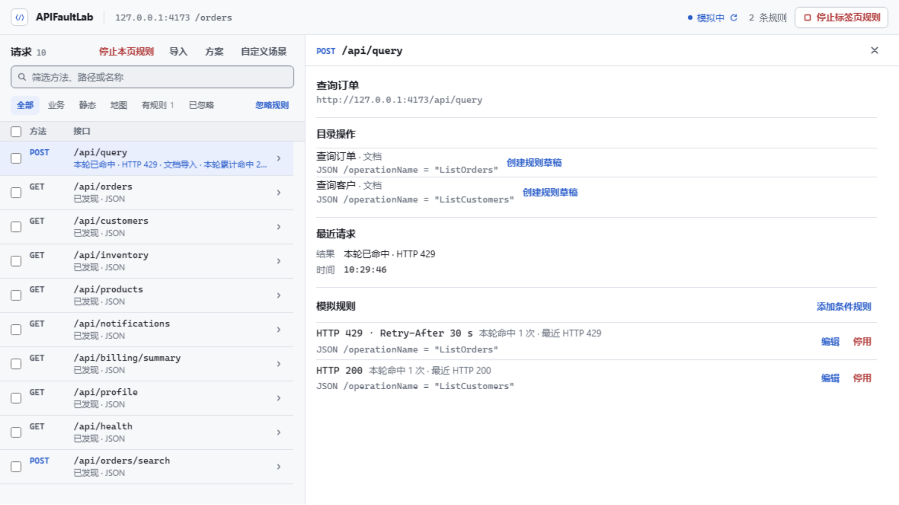
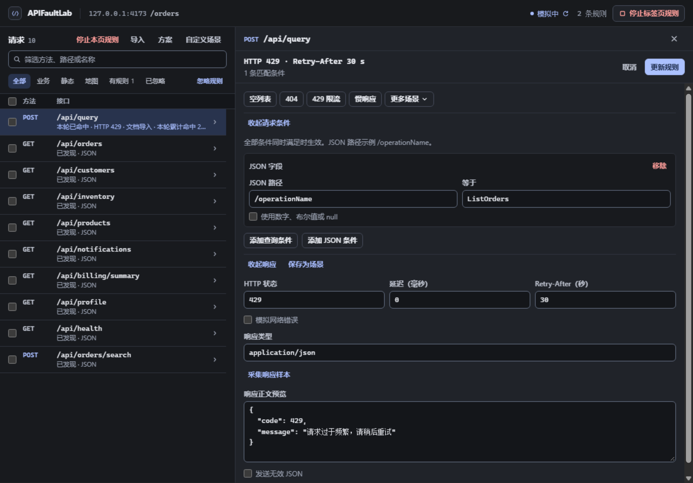
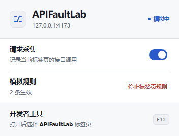

# APIFaultLab

简体中文 · [English](README.en.md)

**自动扫描当前页面的接口，批量模拟异常响应、自定义响应头与重试恢复的 Chrome DevTools 扩展。**

在 F12 中打开 **APIFaultLab**，操作页面时发出的 Fetch 和异步 XHR 请求会自动按当前页面归组展示。你可以在同一页勾选多条查询接口一次设为空列表、为共用 `POST /api/query` 按请求头或 JSON 字段精准分流，或设置「最多生效次数」验证前端重试与恢复。



## 目录

[安装](#安装) · [用法](#用法) · [功能](#功能) · [接入范围与数据](#接入范围与数据) · [开发与验证](#开发与验证) · [贡献](#贡献) · [许可证](#许可证)

## 安装

需要 **Chrome 128 或更高版本**。

### 方式一：直接加载预构建包（推荐给测试与日常使用）

1. 从 [GitHub Releases](https://github.com/zhkai-ybwn/APIFaultLab/releases) 下载最新的 `api-fault-lab-*-chrome.zip` 并解压。
2. 在 Chrome 地址栏打开 `chrome://extensions`，启用右上角「开发者模式」。
3. 点击「加载已解压的扩展程序」，选择解压后的目录。

### 方式二：从源码构建

需要 **Node.js 22.12+（22.x）或 24+**（项目已在 `package.json` 中通过 Volta 固定 Node 24 LTS）。

```bash
git clone https://github.com/zhkai-ybwn/APIFaultLab.git
cd APIFaultLab
npm ci
npm run build
```

构建完成后，在 `chrome://extensions` 加载项目中的 `.output/chrome-mv3` 目录。重新构建后，在扩展管理页点击「重新加载」，再关闭并重新打开 DevTools。

## 用法

### 扫描接口并批量模拟

1. **接入网页。** 打开待测试页面，按 F12，切到 **APIFaultLab** 标签（找不到时展开 `»`）。按提示点「授权此站点」，也可点 Chrome 工具栏中的扩展图标临时接入当前页面。
2. **发现接口。** 正常在网页里切换菜单、查询或翻页，工作台会自动采集实际发出的请求。若页面翻页或筛选会改变 URL 查询参数（如 `?page=2`），可在筛选栏右侧开启「忽略参数」以保持同一页面组。
3. **单条或批量设置。** 用搜索或「业务」缩小列表：
   - 测单条接口：点接口行 → 「添加模拟规则」→ 选择场景，按需添加查询参数/请求头/JSON 条件、自定义响应头或最多生效次数 → 点详情顶部「启用规则」。
   - 批量模拟：勾选多条接口（或表头全选当前筛选结果）→ 「批量设置」→ 选择空列表、404、429 或慢响应等场景 → 点详情顶部「启用 N 条规则」。批量更新已有规则时会保留各条规则的匹配条件。
4. **看效果与恢复。** 回到网页重做原操作，在工作台核对本轮命中与结果。需要复测时，可在「方案 → 从当前规则创建」保存这组规则与复测备注。测完点「停止本页规则」，再次触发即可走真实接口。

### 用本地演示试一次

```bash
node examples/manual-demo/server.mjs
```

1. 打开[本地演示页](http://127.0.0.1:4173/orders)，在 F12 接入后点击「查询订单」和「查询客户」，工作台会采集到共用的 `POST /api/query`。
2. 为订单查询添加规则：将 JSON 字段 `/operationName` 匹配为 `ListOrders`，响应选 HTTP 429。再次查询时，订单返回 429，客户仍返回真实 200。
3. 为客户查询再建一条匹配 `ListCustomers` 的规则，勾选 `POST /api/query` 通过「批量设置」把两条规则一起改成 HTTP 404 并启用。两条查询均显示 404，未匹配的版本查询仍返回真实 200。
4. 点「停止本页规则」后再查询订单，确认恢复 HTTP 200；可通过页面上的「读取计数」核对模拟期间服务端收到的 POST 次数为 0。



## 功能

| 你要做什么 | 操作方式 |
| --- | --- |
| 从大量请求里找业务接口 | 按方法、路径或名称搜索；用「业务」「静态」「地图」筛选，开启「忽略参数」在翻页或筛选时保持同一页面组，批量忽略选中接口，或保存站点级忽略前缀。 |
| 模拟错误、空态、重试或慢加载 | 内置 4xx/5xx、空列表、空对象、`null`、204、业务失败、慢响应与网络错误预设；支持编辑状态码、自定义响应头、响应正文、延迟和最多生效次数（如前 2 次 503 后自动放行真实请求），并可保存为自定义场景。 |
| 只模拟共用 POST 上的一种操作 | 按查询参数、请求头（不区分大小写）或 JSON Pointer 字段匹配。同一路径上的不同业务操作可配置各自响应。 |
| 保存一组条件和响应供复测 | 将规则与复测备注保存成方案，下次在对应页面一键启用；支持导出脱敏摘要或可导入的完整 JSON。 |
| 补充当前页面的接口目录 | 在本地 Web Worker 中导入 OpenAPI 3.0/3.1、Swagger 2.0（JSON/YAML）或 APIFaultLab 接口目录 JSON，并从目录条目一键创建带匹配条件的规则草稿。 |

如果已有源码、接口文档或获授权的请求记录，可以让 Agent 使用随仓库提供的 [接口目录 Skill](skills/apifaultlab-catalog/SKILL.md) 生成标准 JSON 导入当前页面。参见[目录格式](skills/apifaultlab-catalog/references/接口目录格式.md)和[共用 POST 示例](skills/apifaultlab-catalog/references/共用请求目录.json)。

## 接入范围与数据

- **请求范围。** 采集与模拟覆盖主页面的 Fetch 和异步 XHR。要测试首屏加载请求，先授权站点并准备首屏接入，再在同一标签页刷新。接入状态、首屏保护与恢复说明见[使用说明](docs/使用说明.md)。
- **会话控制。** 工具栏弹窗可查看当前标签页的采集状态、暂停采集或停止整个标签页的模拟；只停止当前页面时，使用工作台的「停止本页规则」。
- **本地数据与隐私。** 全本地运行，无远程数据服务、无统计上报。方案、接口目录、忽略规则、站点归组设置和自定义场景存放在当前 Chrome 配置中，可通过「方案 → 数据备份」导出 JSON 或在预览新增/冲突后合并恢复。详见[隐私说明](docs/隐私说明.md)（[English Privacy Policy](docs/PRIVACY.md)）。



## 开发与验证

扩展基于 Manifest V3，使用 WXT、Vue 3 和 TypeScript。项目通过 [check.yml](.github/workflows/check.yml) 在 CI 中运行完整校验与无头 Chrome 回归：

```bash
npm run typecheck
npm test
npm run build
npm run test:chrome
npm run zip
```

- `npm run test:chrome` 会在临时浏览器配置中运行真实 DevTools 回归测试；Chrome 安装在自定义路径时，可通过 `APIFAULTLAB_CHROME_PATH` 指定。
- `npm run zip` 生成可直接加载或上传商店的 Chrome 扩展压缩包（`.output/api-fault-lab-*-chrome.zip`）。
- 架构与边界设计参见[技术选型与架构设计](docs/plans/技术选型与架构设计.md)；Chrome Web Store 上架参考材料见[权限说明](docs/store/permission-justifications.md)与[审核测试指引](docs/store/reviewer-notes.md)。

## 贡献

提问、反馈问题或提出改进，请使用 [GitHub Issues](https://github.com/zhkai-ybwn/APIFaultLab/issues)。欢迎提交 Pull Request。报告问题时请附 Chrome 版本、复现步骤、预期和实际结果（可使用本地演示页或脱敏后的接口信息复现）。

提交改动前请运行 `npm run typecheck`、`npm test` 和 `npm run build` 并说明验证方式。贡献的授权条款见[项目许可](LICENSE)。

## 许可证

项目源码公开，适用 **APIFaultLab 免费自用许可 1.0**。个人及组织可以免费自用和本地修改，公司可在内部用它开发及测试商业项目。请保留原作者署名与许可。向第三方另行分发、重新上架或通过提供插件收费，需要先取得相应权利人的书面授权。 [完整许可](LICENSE)

安装包随附项目许可和[第三方许可声明](THIRD-PARTY-NOTICES.md)。
