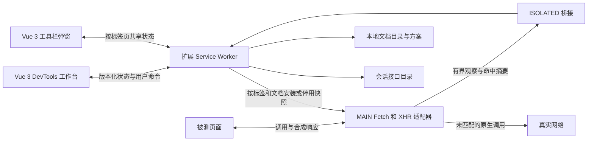

# 技术选型与架构设计

**APIFaultLab · 技术设计 v0.3 · 2026-11-23**\
配套文档 [接口异常测试插件需求设计](接口异常测试插件需求设计.md) · [界面与交互设计](界面与交互设计.md)

## 1. 推荐选型

采用 **Chrome Manifest V3 + WXT + TypeScript + Vue 3**，浏览器基线为桌面 Chrome 142+。Chrome 工具栏 action 提供原生弹窗，`devtools_page` 注册 APIFaultLab 标签页。插件在授权的主页面 JavaScript 环境（`MAIN` world）适配 Fetch 和异步 XHR，在调用原生发送之前按 URL、方法和可选 JSON 字段匹配。接口文档在本地导入。[Chrome Scripting](https://developer.chrome.com/docs/extensions/reference/api/scripting) · [Chrome DevTools Panels](https://developer.chrome.com/docs/extensions/reference/api/devtools/panels)

| 层 | 选型 | 说明 |
| --- | --- | --- |
| 工程与 UI | WXT、TypeScript `strict`、Vue 3、`@wxt-dev/module-vue` | Vue 单文件组件使用 Composition API 和 `<script setup lang="ts">`。WXT 打包弹窗、DevTools 注册页、工作台、Worker、页面适配器与隔离桥接。使用 npm 锁文件。 [WXT 前端框架](https://wxt.dev/guide/essentials/frontend-frameworks) · [WXT 入口](https://wxt.dev/guide/essentials/entrypoints) |
| 页面拦截 | 优先验证 `@mswjs/interceptors` 的浏览器 Fetch/XHR 适配器 | 作为独立适配层评估。通过真实请求客户端、超时、取消及 POST 无真实发送验收后再固定版本。 [MSW Interceptors](https://github.com/mswjs/interceptors#browser-preset) |
| 文档导入 | `JSON.parse`、`yaml` 与定向格式校验 | 本地读取单文件 OpenAPI 3.0/3.1、Swagger 2.0。限制别名展开和文档大小。 [YAML 解析选项](https://eemeli.org/yaml/#tojs-options) |
| 存储与验证 | `chrome.storage.session`、`chrome.storage.local`、`vue-tsc --noEmit`、Vitest Node | 会话摘要和持久方案分别保存在扩展内。Vue 类型与规则逻辑可在浏览器外验证。 [Chrome Storage](https://developer.chrome.com/docs/extensions/reference/api/storage) · [Vue TypeScript](https://vuejs.org/guide/typescript/overview.html) · [Vitest](https://vitest.dev/guide/) |

## 2. 拦截路线和适用范围

| 路线 | 结论 |
| --- | --- |
| **`MAIN` world Fetch/XHR 适配，首版路线** | 在业务调用位置获取请求发起时的页面 URL，并读取所需的 JSON 字段。由页面直接收到合成结果。同页 DevTools 可以照常调试，真实请求仍进入 Network，合成结果在插件行内查看。页面环境可改写网络函数，必须验证接入覆盖。 [Chrome 内容脚本执行环境](https://developer.chrome.com/docs/extensions/reference/manifest/content-scripts#run-time-and-execution-environment) |
| Chrome 调试会话和 CDP `Fetch` | 可以接管浏览器网络请求。同标签页开启 DevTools 会使扩展调试会话断开，且清理时尚未处置的暂停请求可能继续发送。该路线不进入首版实现。 [调试脱离](https://developer.chrome.com/docs/extensions/reference/api/debugger#event-onDetach) · [Chromium 请求清理](https://chromium.googlesource.com/chromium/src/+/refs/heads/main/content/browser/devtools/devtools_url_loader_interceptor.cc#1342) |
| 声明式网络规则 | 支持按方法或 URL 等条件挡住与重定向请求。规则条件没有 JSON 请求体匹配，任意状态与正文需要额外响应源。 [Chrome Declarative Net Request](https://developer.chrome.com/docs/extensions/reference/api/declarativeNetRequest) |
| 项目内 MSW 或独立测试代理 | 作为有明确适配需求时的候选。项目内 MSW 需要被测项目注册 Service Worker。独立代理增加代理范围、HTTPS 和安装维护的开销。 [MSW 浏览器集成](https://mswjs.io/guides/integrations/browser) · [Chrome Proxy](https://developer.chrome.com/docs/extensions/reference/api/proxy) |

首版验证主框架里的 Fetch 和异步 XHR，重点覆盖实际项目使用的客户端。独立 API 域名也可以在页面层合成结果。真实 CORS、预检和缓存行为应通过原生请求验证。提前保存的原生函数、Worker、iframe、同步 XHR、原生表单、`sendBeacon` 等调用需要独立验证或覆盖。页面 CSP、HMR 与已有拦截库会影响接入，首版验证需包含真实测试项目。[Chrome 内容脚本与 CSP](https://developer.chrome.com/docs/extensions/develop/concepts/content-scripts#content-security-policy)

## 3. 模块与页面生命周期

1. **绑定目标。** 工具栏手势以 `activeTab` 授权当前页。工作台通过 `chrome.devtools.inspectedWindow.tabId` 绑定被检查标签页，可按需授予单站点权限。两个入口按 `tabId` 联到同一个 Worker 会话。Worker 对主框架 `documentId` 定向注入适配器与桥接。[Chrome activeTab](https://developer.chrome.com/docs/extensions/develop/concepts/activeTab/) · [扩展 DevTools](https://developer.chrome.com/docs/extensions/how-to/devtools/extend-devtools)
2. **准备就绪。** Worker 校验授权、编译规则和下发版本。页面适配器确认完整版本后，界面显示实际启用状态。授权测试站点可注册 `document_start` 脚本并刷新，覆盖应用提前绑定的网络函数。新文档仍需要规则确认，首包先后顺序需实测。[注入时机](https://developer.chrome.com/docs/extensions/reference/manifest/content-scripts#run-time-and-execution-environment)
3. **切换页面。** Fetch 在调用时读取 `location.href`，XHR 在 `send()` 时读取。发起后冻结其页面 URL 与规则快照。默认用主页面实际 URL 归组。实时匹配使用发起时的页面快照，导航事件推动工作台更新。
4. **刷新与退出。** Worker 在同一个 `tabId` 的主文档同源提交后，从会话状态恢复规则和采集开关，先显示「正在恢复规则」，收到新文档确认后再显示活动。关闭 UI 保持当前状态。跨源主导航、关闭标签页或重启浏览器结束运行会话，已保存的本地方案保持可用。用户停止后立即清除可恢复的规则意图，再等待已接管文档确认。[主框架导航事件](https://developer.chrome.com/docs/extensions/reference/api/webNavigation#event-onCommitted) · [Service Worker 生命周期](https://developer.chrome.com/docs/extensions/develop/concepts/service-workers/lifecycle)

**扩展与页面的职责。** 工作台保留 Vue 草稿和选择，Worker 按标签页串行管理命令与持久化。已确认的 MAIN 快照负责实时匹配、延迟及合成，每个请求无需与 Worker 往返。控制命令由 Worker 定向执行并核对标签页、文档和规则版本。隔离桥接的页面消息只承载有界诊断摘要，按消息类型、发送标签页和文档校验。MAIN 属于宿主页面环境，页面可以观察或改写其中的脚本，权限请求、导入解析和方案保存留在扩展环境。[Chrome 内容脚本隔离](https://developer.chrome.com/docs/extensions/develop/concepts/content-scripts)

## 4. POST 匹配、请求处置与停止

### 匹配与批量启用

- 先按测试标签页、主页面、实际发起时的页面 URL、方法、API origin 与路径筛候选规则。origin 比较含协议、主机与端口。默认精确路径，模板需要显式选择。查询条件和请求体条件各自配置，默认匹配范围在预览中展示。
- 同一 `POST /api/query` 允许在一行内按明确的 JSON 标量等值细分，例如 `/operationName` 等于 `ListOrders`。首版读取有限大小的可解析 JSON 并保证原请求体可继续被原生路径使用。请求体仅在确有候选条件时读取，不执行脚本或任意表达式。流式、上传和不可读正文的条件匹配显示原因。多个条件重叠时拒绝启用，用户可以收紧条件或明确选择匹配整个端点。
- 启用时先验证页面、文档和旧规则版本，再一次编译并安装整份快照。收到当前文档确认后显示已启用。配置有误时旧规则仍运行。无法核实实际版本时显示未确认，重新读取当前适配器状态。进入处理的请求持有当时的规则版本。

| 情况 | 处理 |
| --- | --- |
| 确认未匹配 | 原样调用原生 Fetch 或 XHR 一次，保留浏览器真实网络行为。 |
| 候选 POST 的必需条件无法读取 | 若已进入活动规则的页面、方法与端点范围，显示「无法判断请求条件」并在本地报错。已确认条件不符时正常放行。 |
| 已接管，返回合成响应 | 在本地生成带状态、允许的响应头与正文的响应。首版编辑最终 2xx、4xx、5xx，HTTP 204、205 和 HEAD 使用无正文响应。适配 Fetch 的 Promise 与 AbortSignal，XHR 保持异步事件和属性语义。 |
| 已接管，延迟中取消或执行失败 | 结束本地计时和请求，反馈取消、超时或模拟错误。已接管请求不调用原生发送，也不在失败时自动补发。 |
| 停止模拟 | 适配器停止接管新请求，并结束已接管的延迟任务。Worker 收到当前文档确认后显示已停止。未确认时保留「停止未确认」并提供恢复入口。 |
| 停止后的再次操作 | 记录已放行、收到真实响应或仍等待页面发请求。恢复 UI 由被测应用处理，工作台保留本轮网络证据。 |

命中按文档、规则版本和本次调用记录。当前页面的未接入或已绕过适配器的调用无法凭空保证被模拟。带写入行为的 POST 应在测试环境中，以服务端计数验证实际接管、取消和失败路径。整页刷新前后的首屏接管单独验收。

## 5. 导入、格式识别与方案复用

### 接口文档导入

1. **解析和预览。** 首版支持本地单文件 OpenAPI 3.0/3.1 和 Swagger 2.0 的 JSON/YAML。提取方法、`paths`、操作名、媒体类型、可解析的模型和内联示例。按规范处理 Server 层级和 Swagger 的 `host/basePath/schemes`，在导入预览中由用户确认开发代理、实际 API 域名与前缀。 [OpenAPI 3.1](https://spec.openapis.org/oas/v3.1.1.html) · [Swagger 2.0](https://spec.openapis.org/oas/v2.0.html)
2. **本地引用。** 解析同文件 JSON Pointer 引用，限制深度、重复展开和总大小。外部 `$ref`、`externalValue` 标为未解析，不自动联网。输出为可检查的数据结构，原文档中的认证配置和示例凭据不进入规则。导入或预览阶段不调用业务接口。
3. **归组和合并。** 文档目录按项目持久化，用户把需要的接口关联到当前页面，或在实际观察到后自动关联。合并按方法、映射后的 origin 和路径。精确路径优先，路径模板歧义由用户确认。文档声明、页面调用和收到真实响应各有独立标识。`operationId` 只作为描述，运行时根据实际请求选中规则。

### 响应与复测

- **样本来源。** 优先使用观察到的 HTTP 状态和媒体类型。用户选择「采集响应样本」后，只对符合条件的一次真实请求按需读取正文。Fetch 读取受限的响应副本，XHR 仅处理适用的 `responseType`。正文解析失败或超限时，用文档示例、站点模板或手动配置继续。真实样本仅留会话内存。
- **预览与持久化。** 预览与执行使用同一份已编译响应。保存时选择预览确认过的脱敏合成正文，或固定版本的项目模板和字段修改。后者加载时检查模板版本与结构，缺失时提示补充配置。真实样本不作为跨重启依赖。
- **复测描述。** 方案允许保存前置状态、触发动作和预期 UI。加载后由用户启用，再从原页面触发。规则更新后按新版本计数，旧的命中摘要可查阅。

## 6. 数据和权限

| 数据 | 保存位置与范围 |
| --- | --- |
| 当前页面、接口发现、命中摘要 | 有界 Worker 状态及 `storage.session`。键按 `tabId`、文档、页面 URL 组与端点组织。敏感 URL 字段只在必要匹配阶段使用，目录默认脱敏。 |
| 当前可执行规则与计时器 | MAIN 当前文档内存持有已确认快照。Worker 保存会话确认信息用于恢复界面。 |
| 真实响应和请求体 | 需要解析的部分短期在会话内存中使用。完整正文、鉴权材料和抓取到的完整查询串默认不持久化。 |
| 导入接口、站点配置及方案 | `storage.local` 持久化规范化投影、用户确认的环境与接口映射、模板或合成响应、复测描述及 `schemaVersion`。真实样本和原始接口文档内容仅按需处理。 |
| 忽略规则与自定义场景 | `storage.local` 保存按页面 origin 分组的忽略规则和扩展内可复用的场景。忽略匹配在 Worker 接口目录层执行，活动模拟、采样与停止后恢复所需的记录继续更新。场景应用时复制响应配置。 |

权限基线为 `activeTab`、`scripting`、`storage`、`webNavigation`。DevTools 工作台需要访问页面和站点级早期注入时，依据用户选定的测试来源申请可选主机权限。首版规则可作用于主页面发出的跨域调用，合成发生在页面侧，扩展无需向 API 域名代发请求。本地导入和日志渲染将文档字段作为数据处理。扩展与页面只共享当前规则和必要的摘要。[Chrome 扩展权限](https://developer.chrome.com/docs/extensions/reference/api/permissions)

## 7. 优先验证与开发顺序

| 阶段 | 验证结果 |
| --- | --- |
| 1. 真实工作流原型 | 在本地可计数的服务端和一个真实测试环境中保持 DevTools 打开。验证实际使用的 Fetch/XHR 客户端，覆盖 `readyState`、`loadend`、超时和主动取消。同一 POST 地址的操作 A 被模拟，服务端计数 **0**。操作 B 正常发送 **1** 次。已接管延期 POST 取消或模拟失败时仍为 **0** 次。 |
| 2. 页面和停用 | 同 URL 页签共组。URL 变化切组，迟到响应沿用发起组。验证热注入、普通刷新与 SPA 切换的就绪时序。停止确认后再次查询走真实链路，完整走查有数据、模拟空态、恢复数据。 |
| 3. 文档和批量 | 导入带 POST 的 OpenAPI/Swagger 测试文件，确认代理路径映射，给当前页关联并预设规则。观察后只显示一行。验证批量版本切换、正文匹配失败、规则冲突以及跨重启复用。 |
| 4. 扩展兼容性 | 记录首屏覆盖、同站双标签页隔离、CSP、真实跨域与代理客户端差异。适配器无法可靠覆盖的调用如实显示原因。若必须让合成响应直接出现在 DevTools Network，则单独评估项目内 MSW 或代理。 |

先进行类型检查、Node 单测和生产扩展包静态检查。浏览器实测按约定先说明验证页面、操作范围及预期结果，再取得本次授权。这一版为设计，兼容性与计数结论需由原型验证。
